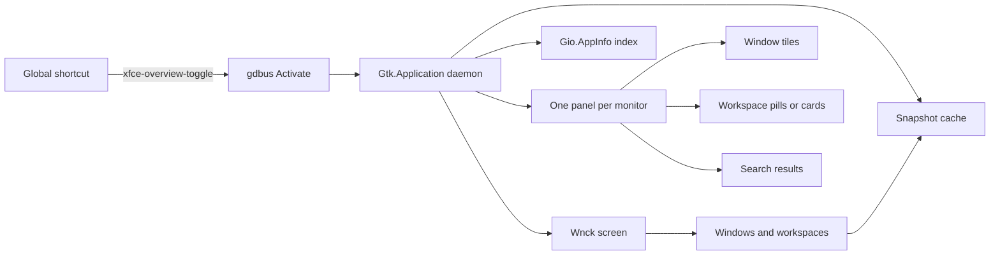

<!--
  Before publishing:
  - Replace <your-github-username> with your GitHub username.
  - Optionally add screenshots under docs/ and link them near the top.
-->

# XFCE Overview — GNOME Window Overview for XFCE

**A GNOME Shell–style Activities Overview for XFCE.**

**XFCE Overview is a GNOME window overview for XFCE.** Press one shortcut to see your windows as thumbnails, switch workspaces, drag windows between workspaces, and launch any installed application — without replacing xfwm4, the XFCE panel, or your existing desktop.

[](#requirements)
[](#requirements)
[](#requirements)
[](LICENSE)

---

## At a glance

| | |
|---|---|
| **Desktop** | XFCE 4.14+ (4.16+ recommended) |
| **Session** | X11 with `xfwm4` — Wayland is **not** supported |
| **Runtime** | Python 3.8+, PyGObject, GTK 3, libwnck 3 |
| **Install** | Per-user, **no root required** |
| **Compositor** | Optional, but strongly recommended for live thumbnails |
| **Also known as** | GNOME window overview for XFCE, GNOME-style Activities Overview, XFCE window switcher |
| **License** | MIT |

---

## What is a GNOME window overview for XFCE?

A **GNOME window overview** is the full-screen view made popular by GNOME Shell: every open window becomes a thumbnail, workspaces are visible and switchable, and typing starts an application search. It lets you step back from individual windows and see your whole desktop at once.

**XFCE Overview brings that GNOME window overview to XFCE.** Instead of replacing your panel or window manager, it adds the missing overview layer on top of xfwm4. You get window thumbnails, workspace navigation, drag-and-drop between workspaces, app search, and keyboard navigation while keeping the lightweight XFCE workflow you already use.

People also search for this feature as a **GNOME-style Activities Overview for XFCE**, **XFCE window overview**, **XFCE window switcher**, **XFCE workspace overview**, or **XFCE expo view**. They all describe the same idea: a GNOME-like overview for managing windows and workspaces on XFCE.

---

## Features

- **GNOME-style window overview** — a clean, dark, translucent overview that appears only when you ask for it.
- **One overview per monitor** — each monitor shows its own windows, grouped by where they physically are.
- **Window thumbnails** — see every window on the current workspace at a glance.
- **Live previews** — with the xfwm4 compositor enabled, thumbnails refresh while the overview is open.
- **Workspace switcher** — click a workspace pill to switch workspaces and stay in the overview.
- **Drag windows between workspaces** — drag a window tile onto a workspace pill (or workspace card) to move it.
- **App search and launcher** — type to search installed `.desktop` applications and press Enter to launch.
- **Usage-aware ranking** — frequently launched apps rank higher in search results.
- **Keyboard navigation** — move through windows and search results with the arrow keys, Tab, and Enter.
- **Mouse actions** — left-click to focus, middle-click to close, right-click for a window menu.
- **“All workspaces” mode** — optionally show one card per workspace instead of only the current workspace.
- **Single-instance daemon** — runs quietly in the background and is toggled through D-Bus.
- **Instant toggle helper** — the included `xfce-overview-toggle` script uses `gdbus` directly, avoiding Python startup latency.
- **Autostart integration** — the installer adds an XDG autostart entry for your XFCE session.
- **No root, no system-wide changes** — everything is installed under your home directory by default.
- **Themeable** — all colors, spacing, borders, and hover effects live in one CSS block at the top of the script.

---

## Requirements

### Desktop and session

- **XFCE 4.14 or newer** with **xfwm4**.
- A working XFCE session. On minimal installs, make sure `xfwm4`, `xfce4-session`, `xfce4-settings`, and `xfce4-panel` are present.
- An **X11 session**. Check with:

  ```bash
  echo "$XDG_SESSION_TYPE"
  ```

  It must print `x11`. If it prints `wayland`, log out and choose the XFCE/X11 session at the login screen.

- The app relies on **libwnck** and X11 window IDs, so a Wayland session will not work.

### Runtime dependencies

| Dependency | Why it is needed |
|---|---|
| Python 3.8+ | Runs the application |
| PyGObject 3 | Python bindings for GTK, GLib, Gio, Pango, and Wnck |
| GTK 3 + GdkX11 + GdkPixbuf + Pango typelibs | User interface, X11 window access, thumbnails, text rendering |
| libwnck 3 + Wnck typelib | Window, workspace, and monitor information |
| GLib/Gio | `.desktop` app indexing, D-Bus, application lifecycle |
| `gdbus` | Fast toggle helper (optional but recommended) |
| xfwm4 compositor | Live thumbnails and transparency (optional but recommended) |

> You do **not** need to install a full development toolchain. The runtime packages above are enough.

---

## Install dependencies

Package names differ between distributions. Use the section for your distribution, then verify the installation with the check at the end.

### Debian / Ubuntu / Linux Mint / Pop!_OS / Kali

```bash
sudo apt update
sudo apt install -y \
  python3 python3-gi python3-gi-cairo \
  gir1.2-gtk-3.0 gir1.2-gdkpixbuf-2.0 gir1.2-pango-1.0 gir1.2-wnck-3.0 \
  libglib2.0-bin
```

### Fedora / Nobara / RHEL 9+ / AlmaLinux / Rocky Linux

```bash
sudo dnf install -y python3 python3-gobject gtk3 gdk-pixbuf2 libwnck3 glib2
```

On immutable Fedora systems (Silverblue/Kinoite), use `rpm-ostree install ...` instead and reboot.

### Arch Linux / Manjaro / EndeavourOS / Garuda / CachyOS

```bash
sudo pacman -S --needed python python-gobject gtk3 libwnck3 glib2
```

### openSUSE Tumbleweed / Leap / Slowroll

```bash
sudo zypper install -y \
  python3 python3-gobject python3-gobject-Gdk python3-gobject-cairo \
  gtk3 libwnck3 \
  typelib-1_0-Gtk-3_0 typelib-1_0-Wnck-3_0 typelib-1_0-GdkPixbuf-2_0 \
  glib2-tools
```

On openSUSE MicroOS, use `sudo transactional-update pkg install ...` and reboot.

### Void Linux

```bash
sudo xbps-install -Sy python3 python3-gobject gtk+3 libwnck3 glib
```

### Alpine Linux

```bash
sudo apk add python3 py3-gobject3 py3-cairo gtk+3.0 libwnck3 gdk-pixbuf glib
```

If the introspection typelibs are split into development packages on your Alpine release, also install `gtk+3.0-dev` and `libwnck3-dev`.

### Gentoo

```bash
sudo emerge --ask \
  dev-python/pygobject:3 dev-python/pycairo \
  x11-libs/gtk+:3 x11-libs/libwnck:3 dev-libs/glib:2
```

### NixOS

For a temporary shell:

```bash
nix-shell -p python3 python3Packages.pygobject3 gtk3 libwnck3 gobject-introspection
```

Or add the same packages to `environment.systemPackages` and rebuild. NixOS is not officially packaged by this project yet.

### Other distributions

Install the equivalents of:

- Python 3
- PyGObject 3 (`gi` Python module)
- GTK 3 with GObject Introspection data
- libwnck 3 with GObject Introspection data
- GLib/Gio tools

If you cannot find a package by name, search your package manager for files named `Wnck-3.0.typelib` and `Gtk-3.0.typelib`. Those are the two most common missing pieces.

### Verify the dependencies

Run this before installing the app:

```bash
python3 - <<'PY'
import gi

for namespace, version in (
    ("Gtk", "3.0"),
    ("GdkX11", "3.0"),
    ("GdkPixbuf", "2.0"),
    ("Pango", "1.0"),
    ("Wnck", "3.0"),
):
    gi.require_version(namespace, version)

from gi.repository import Gtk, GdkX11, GdkPixbuf, Pango, Wnck, Gio, GLib

print("Dependencies OK")
print("GTK %d.%d.%d" % (
    Gtk.get_major_version(),
    Gtk.get_minor_version(),
    Gtk.get_micro_version(),
))
PY
```

Expected output:

```text
Dependencies OK
GTK 3.24.x
```

Also check that the fast toggle helper can work:

```bash
command -v gdbus
```

If this prints nothing, install the GLib tools package for your distribution.

---

## Installation

### Quick start

```bash
# 1. Replace <your-github-username> with your GitHub username
git clone https://github.com/<your-github-username>/xfce-overview.git
cd xfce-overview

# 2. Install for the current user
chmod +x install.sh
./install.sh

# 3. Start the daemon now
~/.local/bin/xfce-overview --daemon &

# 4. Test it
~/.local/bin/xfce-overview-toggle
```

If the overview appears, press **Escape** to close it. Then continue to [Keyboard shortcut](#keyboard-shortcut) to bind a global key.

> The installer does **not** install dependencies. Complete the [dependency step](#install-dependencies) first.

### What `install.sh` does

`install.sh` installs everything for the current user and does not require `sudo`:

| Path | Purpose |
|---|---|
| `~/.local/bin/xfce-overview` | The main application (copy of `xfce-overview.py`) |
| `~/.local/bin/xfce-overview-toggle` | Tiny `gdbus` helper for instant toggling |
| `~/.config/autostart/xfce-overview.desktop` | Starts the hidden daemon at login |

The installer overwrites the installed copy of the application. If you edit the script in the repository, run `./install.sh` again.

### First run

After installation, start the daemon once:

```bash
~/.local/bin/xfce-overview --daemon &
```

Then open the overview:

```bash
~/.local/bin/xfce-overview-toggle
```

At future logins, the autostart entry starts the daemon automatically; you do not need the `--daemon` command again.

### Run directly from the source tree

Useful while developing or testing changes:

```bash
python3 xfce-overview.py --daemon &
python3 xfce-overview.py          # toggle
python3 xfce-overview.py --quit   # stop
```

### Manual installation

If you prefer not to run the installer:

```bash
mkdir -p ~/.local/bin ~/.config/autostart
install -m 755 xfce-overview.py ~/.local/bin/xfce-overview
```

Create `~/.config/autostart/xfce-overview.desktop`:

```ini
[Desktop Entry]
Type=Application
Name=XFCE Overview
Comment=GNOME-style activities overview
Exec=/home/YOUR_USER/.local/bin/xfce-overview --daemon
Terminal=false
NoDisplay=true
X-GNOME-Autostart-enabled=true
```

Replace `/home/YOUR_USER` with your actual home directory. A keyboard shortcut can call `/home/YOUR_USER/.local/bin/xfce-overview` directly; the `xfce-overview-toggle` helper is only a speed optimization.

### System-wide installation (optional)

For multi-user machines, install the application once in `/usr/local/bin`:

```bash
sudo install -m 755 xfce-overview.py /usr/local/bin/xfce-overview
```

Create `/etc/xdg/autostart/xfce-overview.desktop`:

```ini
[Desktop Entry]
Type=Application
Name=XFCE Overview
Comment=GNOME-style activities overview
Exec=/usr/local/bin/xfce-overview --daemon
Terminal=false
NoDisplay=true
X-GNOME-Autostart-enabled=true
```

Users can bind `/usr/local/bin/xfce-overview` to their own shortcut. Note that `/etc/xdg/autostart` starts a daemon for **every** XFCE user; remove the file if that is not what you want.

---

## Keyboard shortcut

The app does not install a global shortcut automatically. XFCE stores shortcuts per user, and the correct key depends on your existing setup.

### Recommended key

| Shortcut | Notes |
|---|---|
| **`Super+Space`** | Reliable on stock XFCE and usually unused. Recommended. |
| **`Super`** | Closest to GNOME, but XFCE often reserves Super for the Whisker Menu. See the conflict note below. |
| **`Super+O`** | Easy to remember, rarely conflicts. |
| **`Super+grave`** | Alternative if your keyboard layout supports it easily. |

`Escape`, arrow keys, Tab, and Enter are handled **inside** the overview and do not need to be configured.

### Create the shortcut with the XFCE GUI

1. Open **Settings Manager → Keyboard** (or run `xfce4-keyboard-settings`).
2. Open the **Application Shortcuts** tab.
3. Click **Add**.
4. Enter the command using a **full path**:

   ```text
   /home/YOUR_USER/.local/bin/xfce-overview-toggle
   ```

   Replace `YOUR_USER` with your username. Avoid `~` and `$HOME` in this field; they are not guaranteed to expand.

5. Click **OK**.
6. Press your chosen shortcut, for example **Super+Space**.
7. If XFCE says the shortcut is already assigned, either reassign it or choose a different key.
8. Test it. Pressing the shortcut should open the overview; pressing it again should close it.

### Create the shortcut from the command line

The following example binds **Super+Space**:

```bash
xfconf-query -c xfce4-keyboard-shortcuts \
  -p "/commands/custom/<Super>space" \
  -n -t string \
  -s "$HOME/.local/bin/xfce-overview-toggle"
```

If the property already exists, omit `-n`:

```bash
xfconf-query -c xfce4-keyboard-shortcuts \
  -p "/commands/custom/<Super>space" \
  -t string \
  -s "$HOME/.local/bin/xfce-overview-toggle"
```

Changes are usually picked up immediately. If not, restart the settings daemon or log out and back in:

```bash
xfsettingsd --replace >/dev/null 2>&1 &
```

Verify the binding:

```bash
xfconf-query -c xfce4-keyboard-shortcuts \
  -p "/commands/custom/<Super>space" -v
```

Remove it:

```bash
xfconf-query -c xfce4-keyboard-shortcuts \
  -p "/commands/custom/<Super>space" -r
```

### Check for conflicts

List existing Super-related shortcuts:

```bash
xfconf-query -c xfce4-keyboard-shortcuts -lv \
  | grep -iE 'super|whisker|overview'
```

On many XFCE installations the Whisker Menu owns **Super**. Reassign Whisker Menu first, either in its properties or in **Keyboard → Application Shortcuts** (look for `xfce4-popup-whiskermenu`), then assign Super to XFCE Overview.

### A note about a lone `Super` key

On XFCE, `Super` is primarily a modifier key. Some setups accept a lone Super press as an application shortcut, but many do not. If **Super** alone does nothing, use **Super+Space** instead. If you specifically want GNOME's lone-Super behavior, a tool such as `xcape` can map a lone `Super_L` press to a key combination.

### Autostart

The installer creates the autostart entry automatically. To manage it graphically:

1. Open **Settings Manager → Session and Startup**.
2. Open the **Application Autostart** tab.
3. Enable or disable **XFCE Overview**.

To add it manually, use the full path to the daemon:

```text
/home/YOUR_USER/.local/bin/xfce-overview --daemon
```

---

## Usage

### Open and close

- Press your global shortcut to open the overview.
- Press the shortcut again, press **Escape**, or click an empty area of the background to close it.
- Clicking a window tile closes the overview and focuses that window.

### Window tiles

Each tile shows the application icon, the window title, and a thumbnail when one is available.

| Action | Result |
|---|---|
| **Left-click a tile** | Focus that window and close the overview |
| **Middle-click a tile** | Close the window |
| **Right-click a tile** | Open a menu to move the window to another workspace or close it |
| **Drag a tile onto a workspace pill** | Move the window to that workspace |
| **Left-click empty background** | Close the overview |

Left-click activation happens on **release**, so dragging a tile does not accidentally focus it.

### Workspace strip

When you have more than one workspace and `WORKSPACE_SCOPE = "current"` (the default), a row of workspace pills appears near the top:

- The **current workspace** is highlighted in blue.
- **Left-click a pill** to switch to that workspace. The overview stays open and rebuilds for the new workspace.
- **Drag a window tile onto a pill** to move that window to the workspace.
- Workspaces that are empty still appear as pills, so you can move windows into them.
- Empty workspaces show a **No windows** placeholder.

In `WORKSPACE_SCOPE = "all"` mode, each workspace is shown as a card instead:

- The current workspace card is highlighted.
- **Left-click a card** to switch to that workspace and close the overview.
- **Drag a tile onto another card** to move the window there.

### Search and launch applications

The search box is shown on the **primary monitor** by default. It searches installed applications from `.desktop` files through Gio.

1. Start typing an application name.
2. The window grid is replaced by matching applications.
3. Use **Down/Up** or **Tab/Shift+Tab** to select a result.
4. Press **Enter** to launch it, or click the result.
5. Clear the search box to return to the window grid.

Search ranking considers, in order: exact name, name prefix, word prefix, substring in the name, keywords/executable name, all search terms, and description. Ties are broken by how often you have launched the application.

Hidden applications (`NoDisplay=true`) and entries that should not be shown in menus are excluded.

### Keyboard reference

| Context | Key | Action |
|---|---|---|
| Anywhere in the overview | `Escape` | Close the overview |
| Window grid | `Right` / `Down` / `Tab` | Select the next window |
| Window grid | `Left` / `Up` / `Shift+Tab` | Select the previous window |
| Window grid | `Enter` | Activate the selected window |
| Search results | `Down` / `Tab` | Select the next result |
| Search results | `Up` / `Shift+Tab` | Select the previous result |
| Search results | `Enter` | Launch the selected application |
| Desktop | Your configured shortcut | Toggle the overview |

Arrow-key navigation applies to window tiles only while the search box is empty. When the search box contains text, the arrow keys move through search results.

### Multi-monitor behavior

- One overview window is created per monitor.
- Windows are assigned to the monitor that contains the center of their geometry.
- Each monitor shows only its own windows.
- By default, the search bar is shown only on the **primary monitor**. Change `SEARCH_ON` to `"pointer"` if you want the search bar on the monitor under the mouse.
- Set `PER_MONITOR = False` if you prefer a single overview on the monitor under the pointer.
- Fullscreen panels are positioned by coordinates because xfwm4's monitor numbering can differ from GTK's. If placement is wrong on your setup, set `USE_FULLSCREEN = False`.

### Workspaces

- Configure the number and names of workspaces in **Settings Manager → Workspaces**.
- Pinned windows (“on all workspaces”) appear on the current workspace.
- The overview survives workspace changes because its panels are sticky across workspaces.
- Drag-and-drop between workspaces requires at least two workspaces.

---

## Configuration

All options are constants near the top of `xfce-overview.py`. There is no separate configuration file yet.

| Constant | Default | Description |
|---|---|---|
| `PER_MONITOR` | `True` | One overview per monitor. Set to `False` for a single overview on the monitor under the pointer. |
| `WORKSPACE_SCOPE` | `"current"` | `"current"`: show the active workspace with a switcher strip. `"all"`: show one card per workspace. |
| `USE_FULLSCREEN` | `True` | Fullscreen each overview panel on its monitor. Set to `False` if your window manager misplaces fullscreen windows. |
| `CACHE_W`, `CACHE_H` | `480`, `300` | Maximum size of cached window snapshots. Lower values save memory; higher values look sharper. |
| `LIVE_PREVIEWS` | `True` | Refresh thumbnails while the overview is open. Requires a compositor. |
| `LIVE_REFRESH_MS` | `500` | How often one window is re-captured (round-robin). |
| `MAX_RESULTS` | `10` | Maximum number of application search results. |
| `SEARCH_ON` | `"primary"` | `"primary"`: search bar on the primary monitor. `"pointer"`: search bar on the monitor under the mouse. |

### Apply configuration changes

If you edited the installed copy:

```bash
~/.local/bin/xfce-overview --quit
~/.local/bin/xfce-overview --daemon &
```

If you edited `xfce-overview.py` in the repository, reinstall first:

```bash
./install.sh
~/.local/bin/xfce-overview --quit
~/.local/bin/xfce-overview --daemon &
```

### Enable the compositor (recommended)

The compositor is what allows the app to capture window contents that are partially covered or currently behind another window. Without it:

- Only the active window can be captured reliably.
- The overview background becomes opaque.
- Live previews are disabled.

Enable it graphically in **Settings Manager → Window Manager Tweaks → Compositor → Enable display compositing**, or from the command line:

```bash
xfconf-query -c xfwm4 -p /general/use_compositing -s true
```

If the property does not exist yet:

```bash
xfconf-query -c xfwm4 -p /general/use_compositing -n -t bool -s true
```

Check the current value:

```bash
xfconf-query -c xfwm4 -p /general/use_compositing -v
```

### Theming

The CSS block at the top of `xfce-overview.py` controls the entire look. Useful selectors include:

```css
#overview { /* full-screen backdrop */ }
#search { /* search entry */ }
.ws-pill { /* workspace pill */ }
.ws-pill.current { /* active workspace pill */ }
.ws-card { /* workspace card in "all" mode */ }
.tile { /* window tile */ }
.tile:hover, .tile.selected { /* hover and keyboard selection */ }
.tile-title { /* window title */ }
.thumb { /* thumbnail area */ }
#results row { /* search result row */ }
.app-name { /* application name */ }
.app-desc { /* application description */ }
```

For example, to use a warmer highlight color:

```css
.tile:hover, .tile.selected {
    border-color: #ff8c00;
    box-shadow: 0 0 16px rgba(255, 140, 0, 0.6);
}
```

### Usage data

Application launch counts are stored in:

```text
~/.local/share/xfce-overview/usage.json
```

Delete this file to reset search ranking. The directory is created automatically the first time you launch an application from the overview.

---

## How it works

XFCE Overview is a single Python file built on PyGObject and GTK 3. It runs as a hidden `Gtk.Application` daemon and creates one fullscreen, undecorated, sticky panel per monitor when opened.



Key implementation details:

- **Single instance** — `Gtk.Application` uses the ID `io.github.local.XfceOverview`. A second launch forwards its command line to the running instance instead of starting another daemon.
- **Toggle path** — `xfce-overview-toggle` calls `org.freedesktop.Application.Activate` over the session bus. This avoids starting Python just to toggle the UI.
- **Window information** — libwnck provides the window list, window types, workspace membership, minimization state, icons, and activation. Only normal, dialog, and utility windows are shown; panels, docks, and skip-tasklist windows are excluded.
- **Thumbnails** — snapshots are captured with `Gdk.pixbuf_get_from_window()` and cached in memory at up to 480×300 pixels. Windows are captured before the overview panels are mapped, so the overview does not appear inside its own screenshots.
- **Live updates** — while the overview is open and a compositor is available, one window is re-captured every 500 ms in round-robin order.
- **Application search** — `Gio.AppInfo` enumerates installed `.desktop` files. The index is rebuilt when the application monitor reports a change.
- **Drag and drop** — tiles carry their X11 window ID in an internal drag target. Dropping a tile on a workspace pill or card calls libwnck's `move_to_workspace()`.
- **Idle behavior** — the daemon is event-driven. It does not poll while the overview is closed.

### D-Bus interface

The toggle helper uses:

```bash
gdbus call --session \
  --dest io.github.local.XfceOverview \
  --object-path /io/github/local/XfceOverview \
  --method org.freedesktop.Application.Activate '{}'
```

You can run the same command manually to toggle the overview.

### Command-line options

```text
xfce-overview --daemon     Start hidden in the background (use for autostart)
xfce-overview              Toggle the overview (starts the daemon if needed)
xfce-overview --quit       Stop the daemon
```

---

## Performance

- **Idle:** the daemon consumes almost no CPU because it waits on libwnck, GTK, and D-Bus events.
- **Opening:** the app captures visible windows, builds tiles, and maps the panels. This is usually fast, but the first open after login may be slightly slower while snapshots are collected.
- **While open:** one thumbnail is refreshed every 500 ms when live previews are enabled.
- **Memory:** snapshots are cached in memory at up to 480×300 pixels each (roughly 560 KB per window at 32-bit color). Memory grows with the number of open windows.
- **Tuning for low-memory systems:**
  - Lower `CACHE_W` and `CACHE_H`.
  - Set `LIVE_PREVIEWS = False`.
  - Increase `LIVE_REFRESH_MS`.
  - Set `PER_MONITOR = False` if you do not need per-monitor overviews.

---

## Known limitations

- **X11 only.** Wayland is not supported because window enumeration and thumbnails depend on X11/libwnck.
- **Designed for XFCE/xfwm4.** Other Wnck-compatible X11 window managers may work, but they are not officially supported.
- **No animations.** The overview appears immediately rather than sliding or fading in.
- **No window resizing from the overview.** Tiles are for switching and moving windows, not resizing them.
- **No application grid or favorites.** Search launches applications, but there is no pinned-app grid.
- **Minimized or unmapped windows** may show the last cached snapshot, or only the application icon if no snapshot exists.
- **Without a compositor**, only the active window can be captured reliably, and the background is opaque.
- **Search is on the primary monitor by default.** This is intentional so the search box does not steal focus on every screen.
- **English UI strings.** The interface is currently not localized.

---

## Troubleshooting

| Symptom | Likely cause | Fix |
|---|---|---|
| `ModuleNotFoundError: No module named 'gi'` | PyGObject is missing | Install `python3-gi` (Debian), `python3-gobject` (Fedora/openSUSE), or `python-gobject` (Arch) |
| `ValueError: Namespace Wnck not available` | libwnck typelib is missing | Install `gir1.2-wnck-3.0` (Debian), `libwnck3` (Fedora/Arch), or `typelib-1_0-Wnck-3_0` (openSUSE) |
| `Namespace GdkX11 not available` | GTK 3 introspection data is missing | Install `gir1.2-gtk-3.0` (Debian), `gtk3` (Fedora/Arch), or `typelib-1_0-Gtk-3_0` (openSUSE) |
| `gdbus: command not found` | GLib tools are missing | Install `libglib2.0-bin` (Debian), `glib2` (Fedora/Arch), or `glib2-tools` (openSUSE); or bind the shortcut to `~/.local/bin/xfce-overview` instead |
| Shortcut does nothing | Daemon not running, wrong command path, or key conflict | Run the toggle command in a terminal, check `pgrep -af xfce-overview`, and verify the shortcut in XFCE Keyboard settings |
| Overview opens on the wrong monitor | xfwm4/GTK monitor numbering differs or fullscreen placement failed | Set `USE_FULLSCREEN = False`; check **Settings → Display** arrangement |
| Panel stays above the overview | Fullscreen/keep-above interaction, or compositor disabled | Enable the compositor; try `USE_FULLSCREEN = False`; set the panel to not reserve space |
| Thumbnails are black or missing | No compositor, or windows are minimized/unmapped | Enable the compositor; focus each window once after login; minimized windows may show an icon |
| Background is opaque | Compositor is disabled | Enable display compositing in Window Manager Tweaks |
| Search box is missing on a second monitor | Default is `SEARCH_ON = "primary"` | Set `SEARCH_ON = "pointer"` or use `PER_MONITOR = False` |
| Super opens the Whisker Menu instead | Key conflict | Rebind Whisker Menu to another key, then bind Super to `xfce-overview-toggle` |
| Configuration changes are ignored | The old daemon is still running | Run `~/.local/bin/xfce-overview --quit`, then start it again with `--daemon` |
| App does not start at login | Autostart entry missing or disabled | Check `~/.config/autostart/xfce-overview.desktop` and **Session and Startup → Application Autostart** |
| App exits immediately | Missing dependency, or another instance is holding the D-Bus name | Run it in a terminal to see the traceback; run `--quit` and try again |
| Drag-and-drop does not work | Only one workspace exists, or the pill/card is not visible | Add a second workspace in **Settings → Workspaces**; use the left mouse button to drag |
| Nothing works on Wayland | X11-only application | Log out and choose the XFCE/X11 session |

### Diagnostics

Run these commands when reporting a problem:

```bash
echo "Session: $XDG_SESSION_TYPE"
xfce4-session --version
xfwm4 --version
python3 --version

python3 - <<'PY'
import gi
for namespace, version in (
    ("Gtk", "3.0"), ("GdkX11", "3.0"), ("GdkPixbuf", "2.0"),
    ("Pango", "1.0"), ("Wnck", "3.0"),
):
    gi.require_version(namespace, version)
from gi.repository import Gtk, GdkX11, Wnck
print("GI dependencies OK")
PY

command -v gdbus
pgrep -af xfce-overview || true
```

To see runtime errors, run the daemon in the foreground:

```bash
~/.local/bin/xfce-overview --quit
~/.local/bin/xfce-overview --daemon
```

Press `Ctrl+C` to stop it, then start it detached again:

```bash
~/.local/bin/xfce-overview --daemon &
```

There is no dedicated log file; errors go to the terminal or the session log.

---

## Updating

```bash
cd xfce-overview
git pull
./install.sh
~/.local/bin/xfce-overview --quit
~/.local/bin/xfce-overview --daemon &
```

`install.sh` overwrites the installed application and autostart entry. Your search ranking data in `~/.local/share/xfce-overview/usage.json` is preserved.

---

## Uninstall

From the repository:

```bash
~/.local/bin/xfce-overview --quit
./install.sh --remove
```

If the repository is no longer available, remove the files manually:

```bash
~/.local/bin/xfce-overview --quit 2>/dev/null || true
rm -f ~/.local/bin/xfce-overview \
      ~/.local/bin/xfce-overview-toggle \
      ~/.config/autostart/xfce-overview.desktop
rm -rf ~/.local/share/xfce-overview
```

For a system-wide installation:

```bash
sudo rm -f /usr/local/bin/xfce-overview \
           /etc/xdg/autostart/xfce-overview.desktop
```

Finally, remove the keyboard shortcut in **Settings Manager → Keyboard → Application Shortcuts**.

---

## FAQ

**Is this a GNOME Shell extension?**
No. It is a standalone Python/GTK application designed for XFCE on X11. It does not require GNOME Shell or any GNOME session components.

**Is XFCE Overview a GNOME window overview for XFCE?**
Yes. It recreates the GNOME Shell window overview experience on XFCE: window thumbnails, workspace switching, drag-and-drop between workspaces, keyboard navigation, and application search — all running natively on XFCE/xfwm4.

**Does it work on Wayland?**
No. It needs X11 window IDs, libwnck, and foreign-window capture. Use an XFCE X11 session.

**Does it replace the XFCE panel or xfwm4?**
No. It runs alongside your existing panel and window manager. It only opens a fullscreen overview when you press your shortcut.

**Does it work on other desktop environments?**
It is designed and tested for XFCE with xfwm4. Other X11 environments that provide libwnck may partially work, but they are not officially supported.

**Does it need root?**
No. The default installer writes only to your home directory.

**Can I use it with multiple monitors?**
Yes. One overview window is created per monitor, and windows are grouped by monitor.

**Why is the search box only on one monitor?**
To avoid stealing keyboard focus on every screen. Set `SEARCH_ON = "pointer"` if you prefer the monitor under the mouse, or set `PER_MONITOR = False` for a single overview.

**Why do some windows show icons instead of screenshots?**
Windows that are minimized, shaded, or unmapped cannot be captured. The app uses the last cached snapshot when available, or the application icon otherwise.

**Can I change the keyboard shortcut later?**
Yes. Edit or remove the entry in **Settings → Keyboard → Application Shortcuts**.

**Can I theme it?**
Yes. Edit the CSS block at the top of the script. Colors, borders, radii, shadows, and typography are all defined there.

**Does it support touchpad gestures?**
No. It is keyboard- and mouse-driven.

**How do I reset app search ranking?**
Delete `~/.local/share/xfce-overview/usage.json`.

**Can I package it for my distribution?**
Yes. See [Packaging](#packaging).

---

## Packaging

The application is a single Python file with no build step.

Suggested runtime dependencies:

```text
python3
python3-gobject (or equivalent PyGObject package)
gtk3 (with GObject Introspection typelibs)
libwnck3 (with Wnck typelib)
glib2 / gio
```

Optional:

```text
xfwm4 with compositing enabled
glib2 tools (gdbus)
```

Suggested install locations:

```text
/usr/bin/xfce-overview
/usr/share/applications/...        (optional launcher)
/etc/xdg/autostart/...             (optional, starts for all users)
```

The app ID is currently `io.github.local.XfceOverview`. If you change it for packaging, update the `xfce-overview-toggle` helper and the D-Bus documentation accordingly.

---

## Contributing

Contributions are welcome.

- Fork the repository and create a topic branch.
- Keep the application a small, dependency-light Python/GTK project.
- Test on XFCE X11 with:
  - compositor on and off,
  - one and multiple monitors,
  - one and multiple workspaces,
  - both `WORKSPACE_SCOPE` modes.
- Do not add new runtime dependencies without discussing them first.
- Keep user-visible strings and documentation in English unless localization is being added deliberately.

When reporting a bug, include:

1. Distribution and version.
2. XFCE version, xfwm4 version, and `$XDG_SESSION_TYPE`.
3. Monitor and workspace layout.
4. Whether the compositor is enabled.
5. Steps to reproduce.
6. Terminal output from running the daemon in the foreground.
7. The diagnostics output from [Troubleshooting](#troubleshooting).

Feature requests and pull requests are welcome. If you test the app on another distribution, a compatibility note in the README is appreciated.

---

## Security and privacy

- The daemon runs with your normal user privileges.
- It does **not** open network ports or send data anywhere.
- D-Bus communication is limited to your session bus.
- Window thumbnails are cached in memory only; they are not written to disk.
- Application launch counts are stored locally in `~/.local/share/xfce-overview/usage.json`.
- Like any X11 window manager or pager, the app can see the titles and geometry of your X11 windows. This is inherent to how X11 works.

---

## License

MIT License. See [LICENSE](LICENSE) for the full text.

---

## Acknowledgements

- [GNOME Shell](https://gnome.org/) for the Activities Overview concept.
- [XFCE](https://xfce.org/), [xfwm4](https://docs.xfce.org/xfce/xfwm4/start), [GTK](https://gtk.org/), and [libwnck](https://gitlab.gnome.org/GNOME/libwnck).
- [PyGObject](https://pygobject.gnome.org/) for the Python bindings.

---

**If XFCE Overview makes your desktop better, consider starring the repository and sharing it with other XFCE users.**
